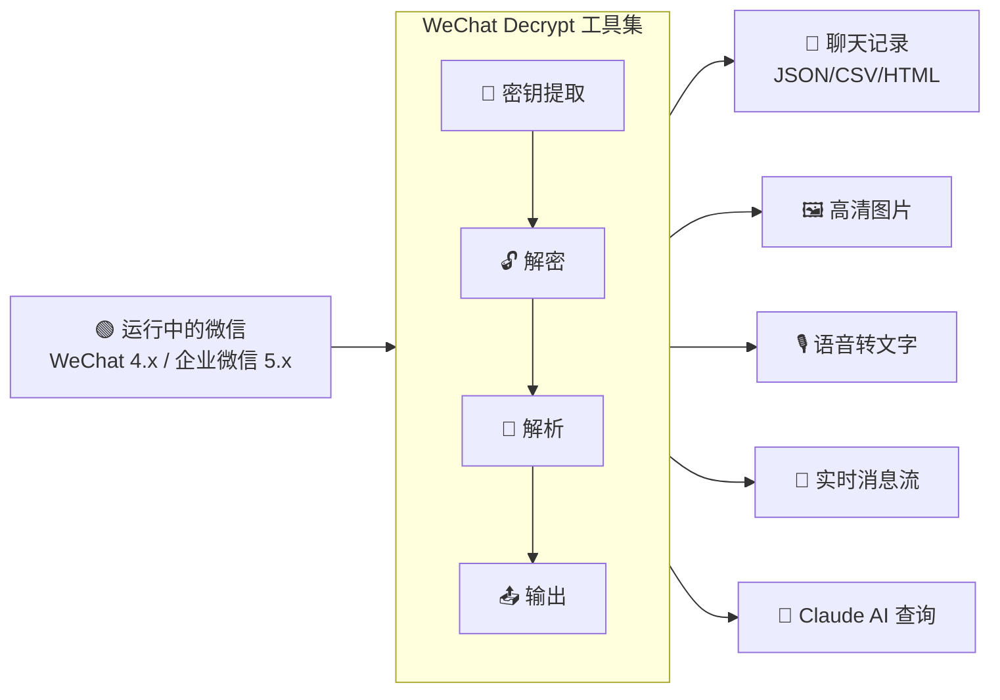
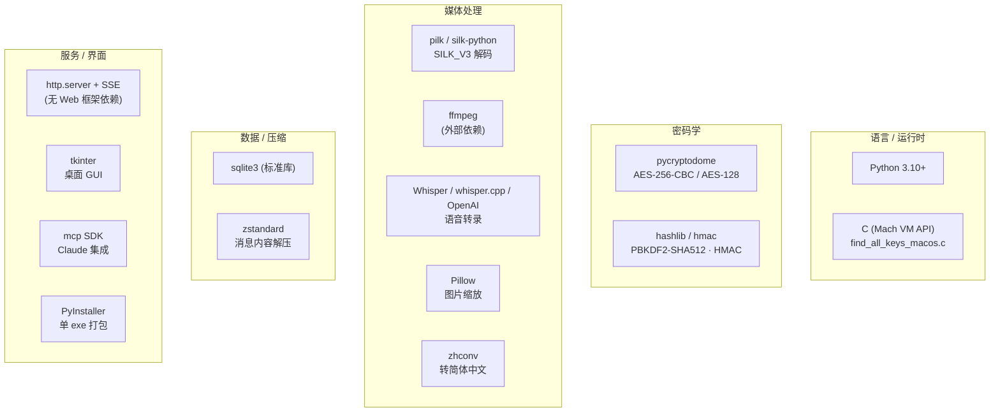
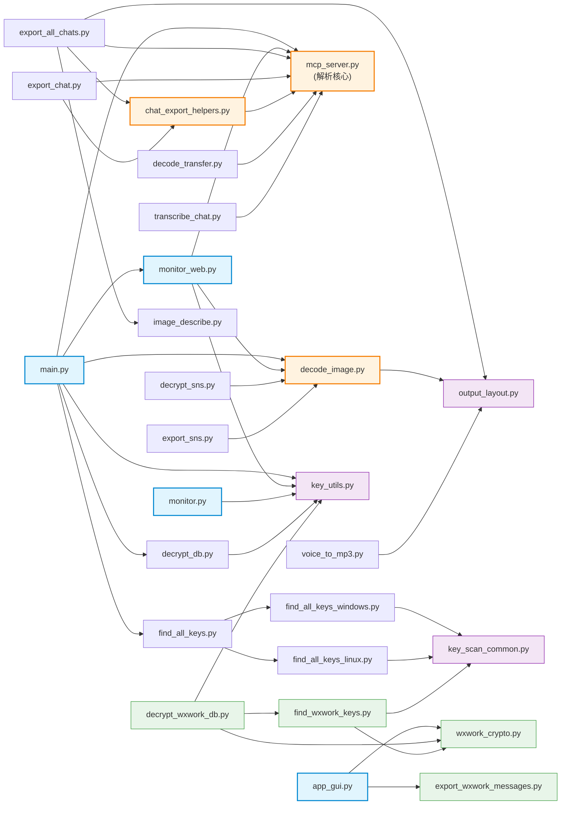
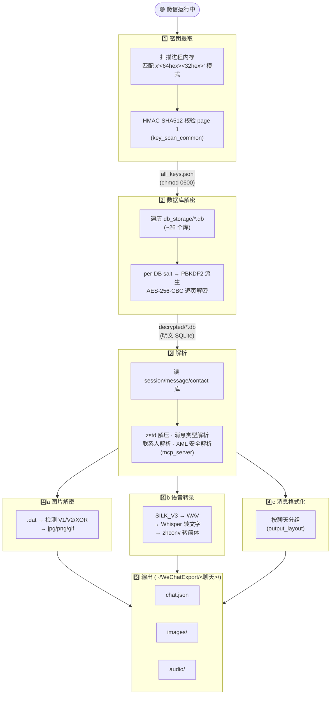
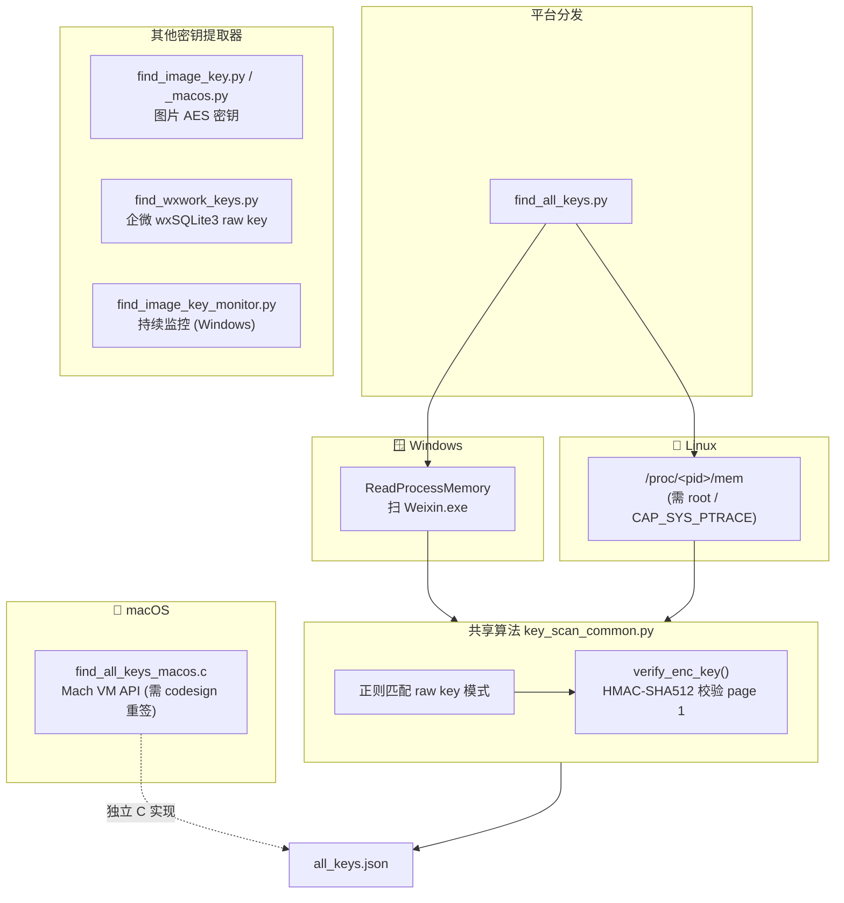
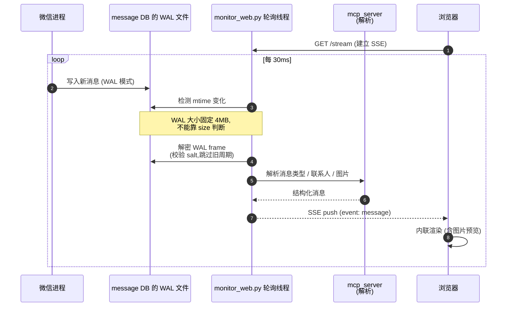
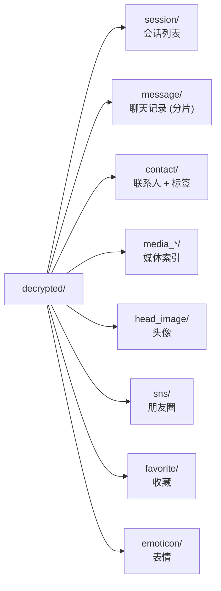

# 项目架构设计文档

> **WeChat 4.x Database Decryptor** — 微信 / 企业微信本地数据库解密 + 数据工具集
> 跨平台 (Windows / macOS / Linux) · Python 3.10+ · 约 19,800 行代码 · 36 个 Python 模块

本文档描述项目的整体架构、分层职责、模块依赖、端到端数据流与关键设计。所有图表使用
[Mermaid](https://mermaid.js.org/) 编写，可在 GitHub、VS Code（装 Mermaid 插件）、
Typora 等直接渲染。

> **关于本版本的范围**
>
> 本版本包含密钥提取、数据库解密、媒体解码、聊天导出、实时监听与 MCP 查询等完整链路。
> 下列两项属可选扩展，**本版本不包含具体实现**，架构图与模块表中保留其位置以便了解整体设计：
>
> - `image_describe.py` — 图片 / 视频内容的 VLM 识别。相关调用点均已做降级处理，
>   缺失时导出与监听照常运行，仅不产生图片描述（配置项 `image_describe_backend` 保持 `none`）。
> - `realtime_db.py` — 实时消息旁路落库到 PostgreSQL。本版本仅提供接口占位，
>   `is_enabled()` 恒为 `False`，`monitor_web` 中所有落库分支自动跳过。
>   文件头注释列出了完整接口，可按需自行实现。

---

## 目录

1. [系统概览](#1-系统概览)
2. [技术栈](#2-技术栈)
3. [分层架构总览](#3-分层架构总览)
4. [各层职责说明](#4-各层职责说明)
5. [核心模块依赖关系](#5-核心模块依赖关系)
6. [端到端数据流水线](#6-端到端数据流水线)
7. [密钥提取子系统（跨平台）](#7-密钥提取子系统跨平台)
8. [解密子系统](#8-解密子系统)
9. [实时监听运行时视图](#9-实时监听运行时视图)
10. [目录结构](#10-目录结构)
11. [关键设计决策](#11-关键设计决策)

---

## 1. 系统概览

本项目从**运行中的微信进程内存**提取 SQLCipher 加密密钥，解密本地 SQLite 数据库，
并衍生出一整套数据工具：实时消息监听、批量导出、图片解密、语音转录、朋友圈解析，
以及面向 Claude AI 的 MCP Server。



| 能力 | 支持范围 |
|---|---|
| 🔓 **数据库解密** | 个人微信 4.0 (SQLCipher 4) + 企业微信 5.x (wxSQLite3 AES-128) |
| 📡 **实时消息监听** | Web UI (SSE) / 命令行 / MCP Server |
| 📦 **批量导出** | 全部聊天 → JSON / CSV / HTML，含增量 + 日期范围 + dry-run |
| 🖼️ **图片解密** | V1 / V2 / 旧 XOR 三种 .dat 格式 + 朋友圈缓存 |
| 🎙️ **语音转录** | SILK → WAV → 文本（local Whisper / OpenAI / whisper.cpp 三 backend） |
| 🪧 **朋友圈** | SnsTimeLine 解析 + 缓存图片解密 + HTML 时间线 |
| 🖱️ **GUI** | Web UI (推荐) + tkinter 桌面 GUI + PyInstaller 单 exe |

---

## 2. 技术栈



> **设计取向**：依赖极简。Web UI 用标准库 `http.server` 手写（不引入 Flask/FastAPI），
> 密码学只靠 `pycryptodome` + 标准库，macOS 内存扫描用独立的 C 程序而非第三方库。

---

## 3. 分层架构总览

系统自上而下分为 **7 层**：入口/展示 → 导出 → 媒体转录 → 数据解析（核心）→ 解密 →
密钥提取 → 配置基石。所有上层最终都解析/读取由解密层产出的明文 SQLite。

```mermaid
flowchart TB
    subgraph L6["① 入口 / 展示层 (Entry & Presentation)"]
        direction LR
        MAIN["main.py<br/>CLI 总入口"]
        WEB["monitor_web.py<br/>Web UI + SSE · :5678"]
        GUI["app_gui.py<br/>tkinter 桌面 GUI"]
        MON["monitor.py<br/>命令行监听"]
        MCPSRV["mcp_server.py<br/>MCP Server (17 工具)"]
        LAUNCH["wechat_decrypt_launcher.py<br/>PyInstaller 入口"]
    end

    subgraph L5["② 导出层 (Export)"]
        direction LR
        EXALL["export_all_chats.py<br/>批量导出 · 增量 · delta"]
        EXCHAT["export_chat.py<br/>单会话"]
        EXMSG["export_messages.py<br/>CSV/HTML/JSON"]
        EXSNS["export_sns.py<br/>朋友圈时间线"]
        EXWW["export_wxwork_messages.py<br/>企业微信导出"]
        HELP["chat_export_helpers.py<br/>共享格式化"]
        LAYOUT["output_layout.py<br/>统一输出布局"]
    end

    subgraph L4["③ 媒体 / 转录层 (Media & Transcription)"]
        direction LR
        TRANS["transcribe_chat.py<br/>语音转文字 (3 backend)"]
        V2MP3["voice_to_mp3.py<br/>SILK → MP3"]
        IMGDESC["image_describe.py<br/>图片 → 文字 (VLM)"]
    end

    subgraph L3["④ 数据解析层 / 核心 (Data Access & Parsing)"]
        PARSE["mcp_server.py — 解析大脑<br/>消息类型解析 · 联系人解析 · XML 安全解析<br/>WAL 解密 · 分页 · 搜索 · 17 个 MCP 工具"]
    end

    subgraph L2["⑤ 解密层 (Decryption)"]
        direction LR
        DECDB["decrypt_db.py<br/>SQLCipher 4 全量解密"]
        DECIMG["decode_image.py<br/>图片 .dat V1/V2/XOR"]
        DECSNS["decrypt_sns.py<br/>朋友圈缓存图片"]
        DECWW["decrypt_wxwork_db.py<br/>企微 wxSQLite3"]
        WWCRYPTO["wxwork_crypto.py<br/>AES-128 per-page 原语"]
        BATCH["batch_decrypt_images.py<br/>CLI 批量解图"]
    end

    subgraph L1["⑥ 密钥提取层 (Key Extraction)"]
        direction LR
        FAK["find_all_keys.py<br/>平台分发"]
        FAKW["find_all_keys_windows.py"]
        FAKL["find_all_keys_linux.py"]
        FAKM["find_all_keys_macos.c<br/>(C · Mach VM)"]
        FIK["find_image_key*.py<br/>图片密钥"]
        FWW["find_wxwork_keys.py<br/>企微密钥"]
        KSC["key_scan_common.py<br/>HMAC 校验 · 模式匹配"]
        KU["key_utils.py<br/>密钥元数据"]
    end

    subgraph L0["⑦ 配置基石 (Foundation)"]
        CFG["config.py — 配置加载器<br/>自动检测数据目录 · 跨平台路径 · exe 路径"]
    end

    L6 --> L5 --> L4 --> L3 --> L2 --> L1
    L6 -.读取明文.-> L3
    L0 -.被所有层依赖.-> L1 & L2 & L3 & L4 & L5 & L6
```



---

## 4. 各层职责说明

| 层 | 职责 | 核心模块 | 输入 → 输出 |
|---|---|---|---|
| **① 入口/展示** | 用户交互、命令路由、实时推送 | `main.py` · `monitor_web.py` · `app_gui.py` · `mcp_server.py` | 用户命令 → 调度下层 |
| **② 导出** | 把解析结果落盘为各种格式，按聊天分组 | `export_all_chats.py` · `output_layout.py` | 明文 DB → JSON/CSV/HTML |
| **③ 媒体/转录** | 语音 SILK 解码转录、图片 VLM 描述 | `transcribe_chat.py` · `voice_to_mp3.py` · `image_describe.py` | SILK/图片 → 文本/MP3 |
| **④ 数据解析（核心）** | 消息类型解析、联系人解析、XML 安全解析、分页搜索、WAL 解密 | `mcp_server.py` | 明文 DB → 结构化消息 |
| **⑤ 解密** | SQLCipher 4 / wxSQLite3 数据库解密、图片 .dat 解密 | `decrypt_db.py` · `decode_image.py` · `wxwork_crypto.py` | 加密文件 + 密钥 → 明文 |
| **⑥ 密钥提取** | 从进程内存/磁盘缓存提取并校验密钥 | `find_all_keys*` · `key_scan_common.py` | 进程内存 → `all_keys.json` |
| **⑦ 配置基石** | 跨平台数据目录自动检测、路径解析 | `config.py` | 环境 → `config.json` |

> ⚠️ **`mcp_server.py` 是双重身份**：它既是面向 Claude 的 MCP Server 入口（④顶部），
> 又是被 7 个模块复用的**消息解析核心库**。所有需要"把原始 DB 行变成可读消息"的地方
> 都调它——这是全项目除 `config.py` 外最关键的枢纽。

---

## 5. 核心模块依赖关系

下图基于 AST 静态分析得出的**真实 `import` 关系**（已省略所有模块对 `config.py` 的依赖，
否则图会被它淹没——`config` 被 **23** 个模块导入，是全局基石）。



**关键枢纽（按被依赖次数 / fan-in 排序）：**

| 模块 | 被导入次数 | 角色 |
|---|---|---|
| `config.py` | **23** | 全局配置基石（图中已隐藏其边） |
| `mcp_server.py` | **7** | 消息解析核心库（+ MCP 入口） |
| `key_utils.py` | 6 | 密钥元数据 strip/匹配 |
| `decode_image.py` | 5 | 图片解码（含 `aligned_aes_block_size` helper） |
| `key_scan_common.py` / `output_layout.py` / `wxwork_crypto.py` | 各 3 | 共享工具 |

---

## 6. 端到端数据流水线

`make all` 对应的完整流程：从运行中的微信到结构化输出。



**导出层的高级特性**（`export_all_chats.py`）：

- `-i` **增量**：按 mtime 跳过未变更的库
- `--delta-only` **时间窗口**：无状态拉取某时段新消息，不覆盖完整 JSON（供外部调度器用）
- `--write-plan-csv` / `--from-plan-csv` **导出计划**：黑/白名单两种模式选择会话
- `-t` **转录**：导出同时转录语音
- `--dry-run` **预览**：只列将导出的会话
- `_export_index.json`：用稳定 `username` 追踪文件，备注/群名变化时自动重命名

---

## 7. 密钥提取子系统（跨平台）

三个平台的进程内存读取方式不同，但**核心校验算法共享**（`key_scan_common.py`）。



> **原理**：微信用 WCDB（SQLCipher 封装）会在进程内存缓存派生后的 raw key，格式为
> `x'<64hex_enc_key><32hex_salt>'`。三平台都扫描此模式，再用 HMAC 校验 page 1 确认正确性。
> macOS 图片密钥更特殊——从磁盘 **kvcomm 缓存**推算，无需进程在线。

---

## 8. 解密子系统

### 8.1 个人微信数据库 (SQLCipher 4)

```
算法: AES-256-CBC + HMAC-SHA512
KDF:  PBKDF2-HMAC-SHA512, 256,000 iterations
页面: 4096B, reserve=80 (IV 16 + HMAC 64)
每库独立 salt + enc_key
```

### 8.2 图片 .dat 三种格式

| 格式 | 时期 | Magic | 加密方式 | 密钥来源 |
|---|---|---|---|---|
| 旧 XOR | ~2025-07 | 无 | 单字节 XOR | 自动检测（对比 magic bytes） |
| V1 | 过渡期 | `07 08 V1 08 07` | AES-ECB + XOR | 固定 `cfcd208495d565ef` |
| V2 | 2025-08+ | `07 08 V2 08 07` | AES-128-ECB + XOR | 进程内存提取 |

V2 文件结构：`[6B signature][4B aes_size][4B xor_size][1B padding]` +
`[AES-ECB 区][raw 明文区][XOR 区]`

### 8.3 企业微信 (wxSQLite3 AES-128 · 实验)

```
16B raw key · 每页按 page index + "sAlT" 派生 AES key
每页 IV 由 page index 派生 · 无 SQLCipher HMAC/reserve 区
```

---

## 9. 实时监听运行时视图

Web UI (`monitor_web.py`) 的实时消息流时序——基于 WAL mtime 轮询 + SSE 推送。



**Web UI 的 HTTP API：**

| 端点 | 说明 |
|---|---|
| `GET /api/history[?chat=&since=]` | 历史消息（可按会话/增量过滤） |
| `GET /api/tags` | 联系人标签 |
| `GET /api/sessions` | 最近会话列表 |
| `GET /stream` | SSE 实时推送 |
| `POST /api/tool` | 触发工具（解密/导出/转 MP3 等） |
| `POST /api/tool/cancel` | 终止运行中的子进程 (SIGTERM) |

---

## 10. 目录结构

```text
wechat-decrypt-main/
│
├── 📂 入口 / 一键脚本
│   ├── main.py                      # CLI 总入口 (decrypt/export/all/status/decode-images)
│   ├── monitor_web.py               # Web UI 总入口 (推荐) · 实时监听 + 工具箱
│   ├── app_gui.py                   # tkinter 桌面 GUI (备用)
│   ├── wechat_decrypt_launcher.py   # PyInstaller 打包入口
│   ├── setup.py / setup.sh          # 安装 / 配置向导
│   └── cleanup.py                   # 磁盘清理
│
├── 🔑 密钥提取
│   ├── find_all_keys.py             # 平台分发 (Win/Linux)
│   ├── find_all_keys_windows.py
│   ├── find_all_keys_linux.py
│   ├── find_all_keys_macos.c        # macOS (C + Mach VM)
│   ├── find_image_key.py            # 图片密钥 (Win/Linux)
│   ├── find_image_key_macos.py      # macOS 从 kvcomm 缓存推算
│   ├── find_image_key_monitor.py    # 持续监控 (Win)
│   ├── find_wxwork_keys.py          # 企业微信密钥
│   ├── key_scan_common.py           # 共享: HMAC 校验 / 模式匹配
│   └── key_utils.py                 # 密钥元数据
│
├── 🔓 解密
│   ├── decrypt_db.py                # SQLCipher 4 全量解密
│   ├── decode_image.py              # 图片 .dat (V1/V2/XOR)
│   ├── decrypt_sns.py               # 朋友圈缓存图片
│   ├── decrypt_wxwork_db.py         # 企业微信数据库
│   ├── wxwork_crypto.py             # 企微 AES-128 per-page 原语
│   └── batch_decrypt_images.py      # CLI 批量解图
│
├── 🧩 数据解析核心
│   ├── mcp_server.py                # 解析大脑 + MCP Server (17 工具)
│   ├── chat_export_helpers.py       # 导出共享格式化
│   └── decode_transfer.py           # 转账消息 CLI
│
├── 📤 导出
│   ├── export_all_chats.py          # 批量导出 (增量/delta/计划CSV/转录)
│   ├── export_chat.py               # 单会话
│   ├── export_messages.py           # CSV/HTML/JSON
│   ├── export_sns.py                # 朋友圈时间线
│   ├── export_wxwork_messages.py    # 企业微信导出
│   └── output_layout.py             # 统一输出布局 (按聊天分组)
│
├── 🎙️ 媒体 / 转录
│   ├── transcribe_chat.py           # 语音转文字 (3 backend)
│   ├── voice_to_mp3.py              # SILK → MP3
│   └── image_describe.py            # 图片 → 文字 (VLM)
│
├── 📡 实时监听
│   ├── monitor.py                   # 命令行监听
│   └── latency_test.py              # 延迟测量 (开发工具)
│
├── ⚙️ 配置 / 构建
│   ├── config.py                    # 配置加载器 (全局基石)
│   ├── config.json                  # 运行时配置 (自动生成)
│   ├── config.example.json
│   ├── WeChatDecrypt.spec           # PyInstaller 描述
│   ├── build.bat                    # Windows 打包
│   ├── Makefile                     # make setup/decrypt/web/all/clean
│   └── requirements.txt
│
├── 🧪 tests/                        # 21 个测试文件 (185+ 用例)
├── 📖 docs/                         # 部署/排错指南 + 字段研究 + 本文档
│
└── 📁 运行时产物 (git 忽略)
    ├── all_keys.json                # 提取的密钥 (chmod 0600, 切勿提交!)
    ├── decrypted/                   # 明文 SQLite (session/message/contact/media/sns/...)
    ├── decoded_images/              # 解密后图片
    ├── exported_chats/              # 导出的 JSON
    └── ~/WeChatExport/              # 统一输出根 (按聊天分组, 项目外)
```

**解密后的数据库分类**（`decrypted/`，约 26 个库）：



---

## 11. 关键设计决策

| 决策 | 原因 |
|---|---|
| **依赖极简，Web UI 用标准库手写** | 避免 Flask/FastAPI 等重依赖，方便 PyInstaller 打包成单 exe (~20MB) |
| **`config.py` 作单一配置源** | 跨平台路径差异巨大（容器路径/ini 检测/sudo home 回退），集中处理，被 23 个模块复用 |
| **`mcp_server.py` 兼做解析核心库** | 消息解析逻辑（类型/联系人/XML）只写一处，导出/Web/MCP 共享，避免格式漂移 |
| **macOS 密钥扫描用独立 C 程序** | Mach VM API 需原生调用 + codesign 权限，Python 难以直接做 |
| **WAL 用 mtime 而非 size 检测** | WAL 预分配固定 4MB，size 永远不变；解密 frame 时校验 salt 跳过旧周期 |
| **统一输出布局 `output_layout.py`** | 聊天/图片/音频按「类型-显示名-username」分组，username 消歧避免同名冲突 |
| **XML 解析加 XXE 防护** | 朋友圈/appmsg XML 拒绝 `<!DOCTYPE>`/`<!ENTITY>` + 200KB 上限，防 SSRF/本地文件读取 |
| **转录三 backend 可切换 + 缓存** | local(隐私) / openai(最快) / whisper_cpp(Metal 加速)，缺依赖静默回退 local，切换后缓存自动失效 |
| **导出支持增量/delta/计划 CSV** | 大数据量场景下避免每次全量；delta 无状态适合外部调度器定时拉取 |
| **密钥文件 `chmod 0600` + git 忽略** | raw key = 全部聊天解密能力，必须严格保护 |

---

> 📌 本文档随代码演进，如发现与实现不符请以源码为准。
> 模块依赖图由 AST 静态分析生成，反映真实 `import` 关系。
